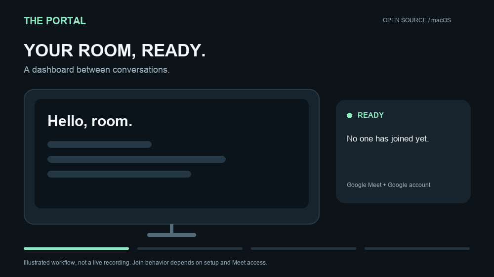

# The Portal

**Setting up with an agent?** Start with [AGENTS.md](AGENTS.md), [the configuration guide](docs/agent-setup.md), and [the human handoff checklist](docs/human-only-checklist.md). Cloning is enough; forking is optional.

Turn a Mac mini, a TV, and a camera into a Google Meet room.



*An illustration of the workflow, not a live recording. See [what we have tested](docs/validation.md).*

[Get started](#set-up-your-own-room) · [Help build it](#help-us-build-the-best-portal) · [Contribution guide](CONTRIBUTING.md) · [Roadmap](docs/roadmap.md)

The Portal displays your dashboard between calls, joins Google Meet invitations sent to the room's Google account, and can open a dedicated drop-in meeting when someone joins. When the call ends, it returns to the same dashboard tab.

**Google Meet and Google accounts only.** No Gmail inbox access, Zoom, Teams, recording, transcription, or hosted account is required. Use an existing Google account with Calendar and Meet access; The Portal does not create an email account.

**Status: source preview, v0.1.0.** This release focuses on the engine, installation, tests, and documentation. The interface is functional; a designed native Mac app and signed installer are future work. Browser automation depends on Google's interface, and passing automated tests does not replace the [live acceptance checklist](docs/acceptance.md).

## What it does

- Joins timed Calendar invitations that explicitly include the configured room account.
- Opens camera and microphone for normal automatic joins, with a live local camera-preview check before entry. Respects manual mutes after startup.
- Detects real participants in a dedicated drop-in Meet room, plays an arrival chime, and opens the call.
- Leaves drop-ins after 15 seconds of confirmed guest absence; scheduled calls default to 60 seconds alone after a guest has been seen, or their scheduled end.
- Preserves your dashboard tab and its state. Each meeting gets a separate owned tab.
- Provides optional, disabled-by-default [private agent controls](docs/agent-api.md).
- Stores Google credentials and control tokens in macOS Keychain.

## Set up your own room

You need a Mac with a signed-in desktop session, Google Chrome, a Google account, internet access, and camera/microphone/speaker hardware. macOS 14 or newer is the initial target; Apple Silicon is the reference test platform. Intel runtime downloads are provided but hardware validation is still pending.

1. **Clone the upstream repository.** Forking is optional. A fork is useful when you want to contribute changes, and it is not required to run a room. You bring your own Google Cloud project and Desktop OAuth client; no company credentials are included.
2. Install [Google Chrome](https://www.google.com/chrome/) and Apple's Command Line Tools. In Terminal, run `xcode-select --install` if you do not already have them, and wait for that installation to finish.
3. Clone upstream and run setup:

   ```bash
   git clone https://github.com/themobilefirstco/the-portal.git
   cd the-portal
   ./setup.command
   ```

   Clone your fork instead when you are contributing changes back.

   Setup downloads a pinned official Node runtime, verifies its SHA-256, builds the Keychain helper, runs the full test suite, installs a user login service, and opens room controls. You do not need Homebrew or `npm install`. Allow your own Portal helper to access its credentials if macOS asks. Setup refuses to replace a running active call.
4. In room controls, save the room name, **the Google account's actual sign-in email**, and time zone.
5. Follow the [Google connection guide](docs/google-setup.md). Create your own Google Cloud project and Desktop OAuth client, import its JSON, and connect the room account. Then sign in to the **separate room Chrome profile** with the same account and click **Check account**.
6. Select and test your devices in Google Meet. The Portal cannot grant macOS permissions for you. Complete a short invited test call, then choose **Resume auto-join**. New installations are paused by default.
7. Optional: follow the [drop-in room guide](docs/drop-in.md), [create a branded room URL](docs/branded-room-url.md), and add your dashboard address.

The Google setup is required because you bring your own OAuth client. There is no shared public OAuth client or claim that Google has verified this project. Gmail and Workspace accounts have different consent-screen steps; the guide covers both.

## One memorable URL for your team

Give each room an address such as **`https://meet.example.com/miami`**. A teammate opens it and joins Google Meet; The Portal detects the visitor and automatically joins from the Mac mini.

**[Create your branded room URL →](docs/branded-room-url.md)** includes a Vercel redirect template, domain/DNS instructions, team-access guidance and an end-to-end checklist. No public server on the Mac is needed. Google Meet controls who can enter.

## Help us build the best Portal

Meeting rooms should be easy to join and easy to trust. Help us make The Portal the most reliable, welcoming open-source Google Meet room for a Mac mini.

**Your first PR does not need to be big.** Fix a confusing setup step. Reproduce a browser failure with a synthetic test. Improve recovery after a network outage. Every contribution that makes the next room easier to set up matters.

- **Have a Mac mini?** Follow the guide and [report your setup results](https://github.com/themobilefirstco/the-portal/issues/new?template=setup-report.yml). A documented failure is useful too.
- **Write code?** Pick a task from the [roadmap](docs/roadmap.md), fork the project, and open a draft PR. Include the problem, the fix and how you tested it.
- **Care about a great Mac experience?** Help define accessible onboarding and recovery flows. The native app comes after the engine and setup are dependable.
- **Know someone building meeting rooms?** Share the project. Star it if you want to help others discover it, and watch releases for future updates.

Read [CONTRIBUTING.md](CONTRIBUTING.md) for a safe development setup. Keep PRs focused; open an issue before a large change. Never include real credentials, meeting links, attendee details or browser profiles. We welcome first-time contributors, documentation improvements and candid bug reports.

## Everyday use

Run `Open Portal.command` to reopen the authenticated control page. A bare `http://127.0.0.1:4280` page deliberately cannot change settings without its control key. Run `Stop Portal.command` to stop the controller and disable login startup, preserving settings and credentials.

The service runs **after this macOS user logs in**, not at the FileVault unlock screen. It prevents idle sleep while active, but does not configure automatic login, TV power, power-loss restart, or network availability. See [installation and operation](docs/installation.md).

**Update:** leave any active call, pull a reviewed release, and run `./setup.command` again. Setup stages application files and checks startup. If activation fails, it attempts to stop the new service and restore the previous installation; if stopping fails, it preserves both copies for manual recovery. Google state is kept separately. This preview requires source updates; it does not silently download app updates.

## Development

```bash
bash scripts/bootstrap.sh     # runtime and Keychain helper only; no service installation
runtime/node scripts/check.mjs
runtime/node scripts/test.mjs # full suite including temporary headless Chrome
runtime/node scripts/test.mjs --unit
```

Tests use synthetic accounts, temporary state, and temporary browser profiles. They do not join real meetings. Full browser tests require Chrome; the test runner refuses to silently skip it on macOS. Google OAuth is disabled in the synthetic HTTP-test mode.

See [architecture](docs/architecture.md), [contributing](CONTRIBUTING.md), [security](SECURITY.md), [troubleshooting](docs/troubleshooting.md), and [validation status](docs/validation.md), [code/security review](docs/qa-review-2026-10-31.md). Runtime downloads and bundled notices are described in [third-party notices](THIRD_PARTY_NOTICES.md).

## Important boundaries

The Portal reads the account's **primary Calendar**, not its email inbox. Pasted links in descriptions are not enough: invite the account and use the event's Google Meet conference field. Room-resource calendars and email aliases are not interchangeable with a Google user login in this release.

Drop-in detection starts after someone actually joins; visiting a URL, opening a preview, or waiting for admission does not count. Meet's host, organization, and audience settings still apply. The Portal cannot bypass admission. Drop-ins have a three-hour maximum; unknown participant data never means “everyone left.”

Camera/mic controls being on are not proof that a remote participant hears and sees the room. Confirm two-way media and the chime with a person during setup. Keep Chrome up to date and rerun the acceptance checklist after major browser or OS changes.

MIT licensed. Built by The Mobile-First Company. Not affiliated with or endorsed by Google or Apple.
