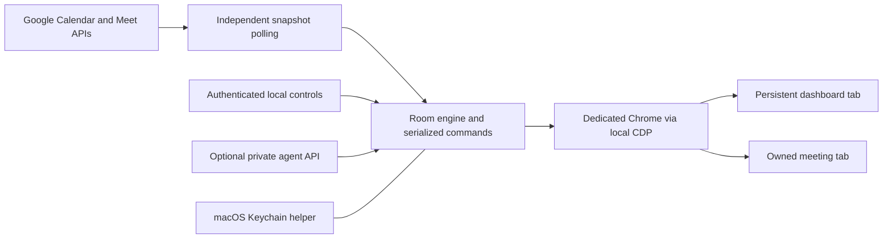

# Architecture

The Portal is a local Node service, a small macOS Keychain helper, and a browser control panel. It uses Google APIs for metadata and a dedicated installed Chrome profile for real meeting participation. It is not a native media implementation or an officially managed Google Meet hardware device.

## Modules

| File | Responsibility |
| --- | --- |
| `config.mjs` | Empty/default room identity, validation, version and port bounds. |
| `google.mjs` | Desktop OAuth state/PKCE, verified identity, refresh single-flight, revocation and Calendar pagination. |
| `secrets.mjs`, `native/Keychain.swift` | Keychain-backed credentials; stdin transport prevents secrets appearing in command arguments. |
| `poller.mjs` | Independent IO, completed snapshots, generation invalidation and polling cadence. |
| `schedule.mjs` | Event normalization, exact attendee eligibility, freshness, overlap and rejoin policy. |
| `drop-in.mjs` | Immutable space identity and active-participant observations, excluding the room itself. |
| `attendance.mjs`, `media-startup.mjs` | Continuous absence timers, preview recovery and initial media-state confirmation. |
| `chrome.mjs`, `native-chrome.mjs` | Owned targets, private profile, Launch Services and validated random loopback debugger endpoint. |
| `meet-page.mjs` | Narrow English Meet-page adapter. Unknown UI fails visibly rather than triggering broad clicks. |
| `server.mjs` | State coordination, protected control routes, scheduling and bounded lifecycle behavior. |
| `agent-api.mjs` | Bearer-token commands, request IDs, rate limits and shared health assessment. |
| `deployment.mjs`, `install.mjs` | Staged source installation, activation check and file rollback. |

## Invariants

One controller owns one room profile and at most one meeting tab. It never navigates the dashboard tab to a meeting. Successful departure means the owned target is confirmed closed; failures remain in a leaving state and are retried. Manual departure is remembered.

Calendar polling runs outside the command queue so slow API requests do not stall the scheduler or Leave. Only completed snapshots are published; changing/disconnecting an account invalidates in-flight results. Other state-changing actions remain serialized. Setup-only actions are rejected during calls.

New installations start paused. Normal joins require the configured account identity and usable local camera-preview frames. After entry the engine checks camera/mic controls across observations and can repair one initial mute per device. Later manual mutes are respected. This does not measure remote audio/video delivery.

The dedicated Chrome instance is launched through macOS Launch Services, which preserves normal browser permission behavior. Its remote debugging endpoint is random and loopback-only, discovered from its private profile. Tests instead use a headless pipe and synthetic pages. No page from a real Google account is used by automated tests.

## Timing and priority

Calendar refresh is every 30 seconds after completion; scheduling ticks every 3 seconds. A snapshot older than 90 seconds prevents new scheduled calls and drop-ins. New meetings normally join within five minutes of their start, while bounded recovery of a previously active call may happen later. At most three opening attempts are automatic.

Active scheduled calls are preserved during overlap. A due scheduled invitation can preempt an agent call or drop-in. Scheduled calls end at their current Calendar deadline plus any local extension. Drop-ins use fresh API attendance, a 15-second confirmed-absence timer and a three-hour maximum. Scheduled alone-departure defaults to 60 seconds after seeing another participant. Missing counts reset timers.

## Security and state

Controls use loopback, strict Host/Origin checks, a private control key and a restrictive CSP. The agent API has a separate optional bearer token and rejects browser-origin requests. Google credentials and control secrets use Keychain; ordinary JSON settings/history have owner-only filesystem permissions and atomic replacement.

The Keychain service name includes a hash of the state path to isolate development installations. Test HTTP servers explicitly use an in-memory secret store with browser startup and real OAuth disabled. Do not use test mode for an actual room.

Account sign-in, Calendar freshness, drop-in health and dashboard presence are distinct readiness signals. Idle devices are reported as not checked. Saved browser verification is rechecked at the meeting preview and invalidated when the page requires a different account.

## Scope and next work

The native designed app, notarized distribution, signed automatic updates, named-display control, hardware reselection, calendar resources, organizer allowlists and office-hour policies are not implemented in this preview. Keep these as explicit future work instead of advertising them as current features. Google Meet UI changes remain a maintenance responsibility.
